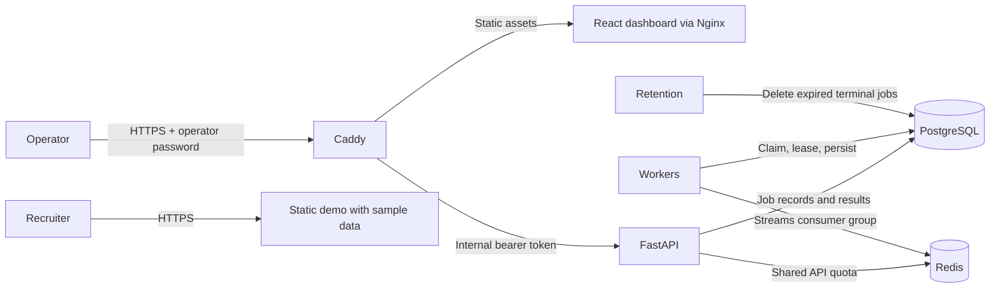

# Deployment guide

Use the static build for recruiter access. The live system can run privately on one Linux VM with Docker Compose and Caddy. These are deployment options for review.

## Hosting options and monthly costs

Estimates are in USD from provider pages checked in November 2026. Budget separately for a custom domain, storage or transfer overages, taxes, and any workspace fees.

| Option | Expected recurring cost | What runs |
| --- | --- | --- |
| Cloudflare Pages Free | **$0** with the provider subdomain and static asset hosting | Read-only React demo built with `VITE_TASKFLOW_DEMO=true`. No compute or database services are needed. [Cloudflare static pricing](https://developers.cloudflare.com/pages/functions/pricing/) |
| DigitalOcean Basic Droplet | **$12** for 1 vCPU and 2 GiB RAM. **$14.40** with weekly Droplet backups at 20%. | Private live dashboard, Caddy, FastAPI, one worker, PostgreSQL, and Redis on the same VM. [Droplet pricing](https://www.digitalocean.com/pricing/droplets) · [Backup pricing](https://docs.digitalocean.com/products/backups/details/pricing/) |
| Render managed services | **About $30** in entry compute charges | $7 web service, $7 worker, $6 PostgreSQL, and $10 Redis-compatible Key Value. Budget for storage and backups, and configure equivalent ingress authentication and a scheduled retention job. [Render example](https://render.com/articles/production-rails-hosting-guide) · [Render pricing](https://render.com/pricing) |

The 2 GiB VM is a starting point for a lightly used interview instance with prebuilt application images and one worker. Building images can temporarily need more memory. The benchmark used a separate host with a larger memory budget. Check memory, CPU, disk growth, and queue delay before changing replica counts.

## Live topology



The production profile publishes Caddy on ports 80 and 443. The data network is internal, and PostgreSQL and Redis have no published ports. Operator Basic authentication applies at the edge. Caddy sends a separate bearer credential to FastAPI over the private application network. Job writes also check a supplied browser origin against the configured HTTPS origin. This profile uses one operator identity. A multi-user deployment needs user and tenant isolation.

## Host configuration

1. Choose a hostname, provision a supported Linux VM with Docker and the Compose plugin, and point its DNS record at the VM. Allow public TCP 80 and 443, restrict SSH to your administrative access, and keep the OS patched. Configure the real hostname and contact email.

   ```sh
   cp deploy/.env.example deploy/.env
   ```

2. Create a strong unique operator password, then generate its bcrypt hash. Enter the password at Caddy's prompt.

   ```sh
   docker run --rm -it caddy:2-alpine caddy hash-password
   python3 deploy/init_secrets.py
   ```

   Paste the hash when the initializer prompts for it. The script generates separate API, PostgreSQL, and Redis credentials. The host directory is restricted to its owner, and Compose mounts the individual files read-only into the services that need them. Keep that directory outside backups shared with reviewers. Secret rotation needs coordination between the services. In particular, replacing the file alone does not update the password of an existing PostgreSQL role.

3. Build or prebuild the images, then start the protected stack on the chosen host.

   ```sh
   docker compose --env-file deploy/.env -f deploy/compose.yaml config --quiet
   docker compose --env-file deploy/.env -f deploy/compose.yaml \
     up -d --build --wait --scale worker=1
   ```

   Confirm DNS and automatic certificate issuance. From a fresh browser session, verify that the dashboard asks for credentials before serving data, then sign in as `operator`. Submit the sample CSV and inspect its result. Check service status and retry behavior before sharing the hostname.

4. Establish backups and restore checks. The production profile runs retention every six hours. It defaults to 30 days from terminal completion and removes the job, payload, result, and related attempts in batches. Pending and running jobs are preserved. Backup copies have their own retention.

   Run the backup from the repository root. Use a private directory outside the checkout, such as `$HOME/.local/state/taskflow/backups`. The directory is accessible only to its owner, and each run creates a new owner-only dump file.

   ```sh
   (
     set -eu
     umask 077
     backup_dir="$HOME/.local/state/taskflow/backups"
     install -d -m 700 "$backup_dir"
     backup_file=$(mktemp "$backup_dir/taskflow-XXXXXXXX.dump")
     if ! docker compose --env-file deploy/.env -f deploy/compose.yaml \
       exec -T postgres pg_dump -U tasks -d tasks -Fc > "$backup_file"; then
       rm -f -- "$backup_file"
       exit 1
     fi
     printf 'Backup written to %s\n' "$backup_file"
   )
   ```

   Store the dump off the VM in a protected destination and test restoring it into an isolated PostgreSQL instance. Schedule backups and configure alerts for disk usage, failed retention runs, Redis memory, API availability, and queue delay. Re-run the recovery demo on an isolated environment after infrastructure changes.

## Security review

| Area | Implemented | Operational boundary |
| --- | --- | --- |
| Authentication | Caddy bcrypt operator authentication, internal constant-time bearer comparison, no-store responses, production API docs disabled | The default Compose file is for local development. Protect credentials and configure DNS, TLS, and firewall rules before exposing the live profile. |
| Rate limits | Atomic Redis windows shared across API processes. Defaults are 240 reads and 20 writes per minute per deployment. Unauthorized and disallowed-origin requests do not use quota. | Excess requests return `429` with `Retry-After`. When Redis is unavailable, guarded API requests return `503`. The edge has no per-IP login throttling. |
| Input validation | 2 MiB request cap before JSON parsing, 512 KiB CSV cap, row and field limits, child-process deadline | Each protected request can still use bandwidth. Use the static demo for public traffic. |
| Secrets | Ignored, restricted directory; file-backed API, PostgreSQL, and Redis credentials; secret values masked in settings representations | Docker administrators can access mounted files. Rotate after exposure and review who can manage the host. |
| Retention | Deletes terminal jobs and attempts in batches; production retention defaults to 30 days | Dashboard counts reflect retained history. Backups need their own expiry policy. |
| Reliability | PostgreSQL dispatch records and leases, durable Redis Streams, bounded attempts and container logs | One VM is a single point of failure. Delivery remains at least once. Redis uses a 128 MiB cap with no eviction, so memory pressure can interrupt queue writes and quota enforcement. |

Production verification still needs a real hostname, public TLS issuance, a tested off-host restore, a host firewall, and monitoring. The Compose profile and application checks can be exercised on a local test stack before committing to a provider.
